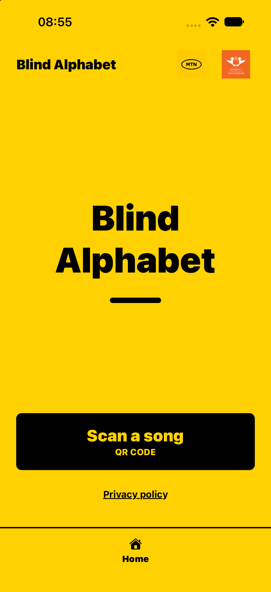
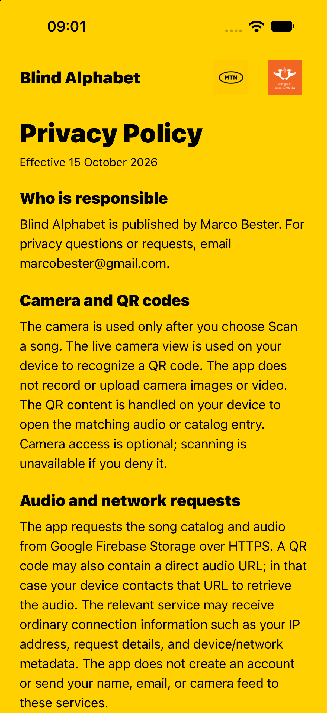
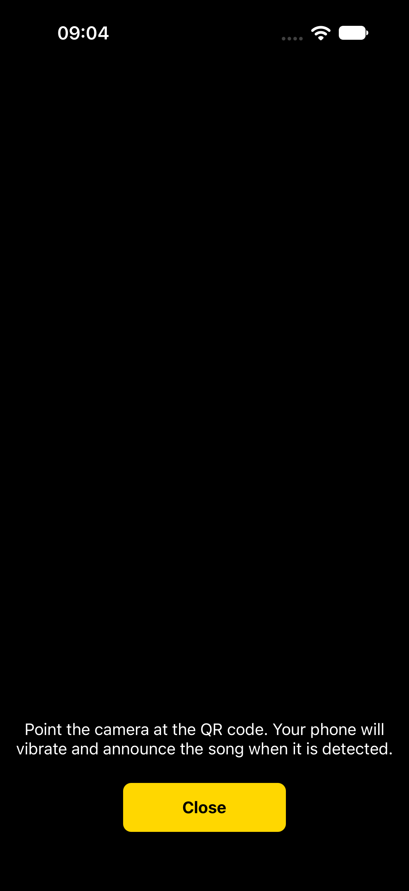
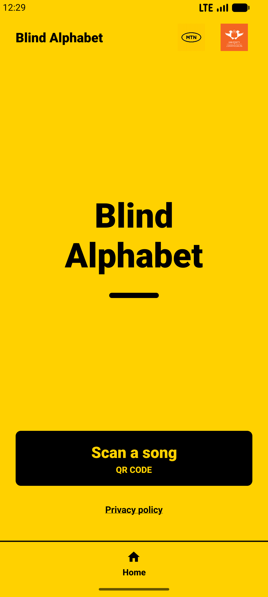
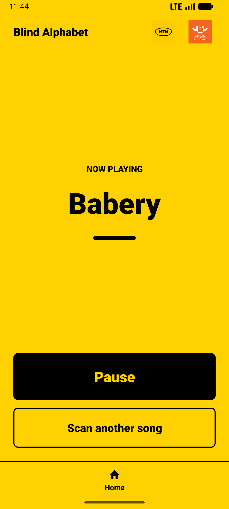
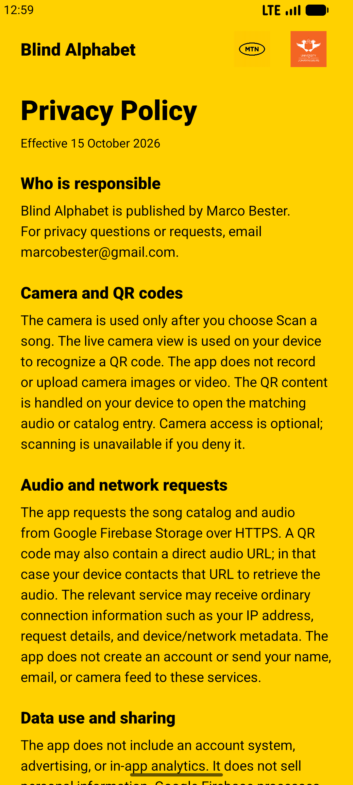

# App Screenshots

Android emulator captures at 1080 x 2400 pixels.

| Screen | Screenshot | State |
| --- | --- | --- |
| iOS Home |  | iPhone 18 Pro simulator, ready to scan |
| iOS Privacy |  | In-app privacy policy |
| iOS Scanner (test only) |  | Scanner UI verified; simulator camera feed is blank |
| Home |  | Home screen, ready to scan |
| Player |  | Babery loaded and playing |
| Privacy |  | In-app privacy policy |

The iOS captures are 1206 x 2622 pixels from an iPhone 18 Pro simulator. The iOS and Android scanner captures are for QA only; simulator camera feeds are not part of the storefront set.